<div align="center">

<p align="center">
<a href="README.md"></a><a href="ARCHITECTURE.md"></a><a href="PAPER.md"></a><a href="LICENSE.md"></a>
</p>

<picture>
  <source media="(prefers-color-scheme: dark)" srcset="docs/images/page-banner-paper-dark.svg">
  <source media="(prefers-color-scheme: light)" srcset="docs/images/page-banner-paper-light.svg">
  
</picture>

<br><br>

[**Results**](#5--results) &nbsp;·&nbsp;
[**Limits**](#6--limits) &nbsp;·&nbsp;
[**Reproduce**](#7--reproduce-the-numbers)

<br>


</div>

<br>

# Agent Customs: checking AI agents from other websites before they run in your browser

> **Summary.** On the Open Agentic Web, and with Google A2A and MCP, one site's assistant can hand a request to an agent published by another site. Today the visitor sees a consent card with the partner's name and address, while the partner's instructions, tool schemas and links go straight into the calling model, unread.
>
> Agent Customs reads those files first, in the browser, with fixed rules. It stamps the partner, remembers the approved version, and keeps three locks on while it runs.
>
> In the benchmark it blocks or holds **86 of 98** attacks (87.8%) and blocks **none of 61** honest controls, at no model cost and a median of 1.74 ms. On **237 public MCP servers and A2A cards it had never seen**, 13 (5.5%) were held without a good reason. Attack wording the rules were never written for still gets through often (they held 4 of 20 outside wordings and 11 of 18 in the latest test), which is why the runtime locks exist.

<br>

## 1 · The problem

When a partner network runs inside your page, three things can go wrong that the browser's usual protections (same-origin policy, CSP) do not cover:

1. Hidden instructions. Text a person cannot see but a model reads: Unicode tag characters (`U+E0000` to `U+E007F`), zero-width characters, right-to-left overrides, look-alike letters from other alphabets, Base64, or orders tucked into schema fields that no consent card shows (`inputSchema`, `outputSchema`, `annotations.title`, `prompts[].messages`, A2A `skills[].name`).
2. Dangerous combinations in polite wording. A tool that reads outside text, one that touches private data (environment settings, `sly_data`, a credential field) and one that sends data out (a webhook, another host) make a path for a leak, however the descriptions are worded. Self-declared MCP hints such as `readOnlyHint` cannot be trusted to rule that out.
3. Changes after approval, and encoded leaks. A partner can pass on day 1 and add a harvesting instruction on day 2 (a rug pull). A compromised turn can encode a secret, for example line-wrapped Base64 inside a tool argument, past a simple word filter.

## 2 · Threat model

| | Trusted | Controlled by the attacker |
| :--- | :--- | :--- |
| **Host page and runtime** | The host page and its CSP (`img-src 'self' data: blob:`), Cognizant's unmodified `Engine`, an origin used only for this site | Partner manifests, `.network.json`, A2A cards, MCP `tools/list` and `server.json`, partner replies and tool results |
| **Signing key** | The published ECDSA P-256 key (`.well-known/agent-customs-key.json`, key id `-DC99sDa-qJjBp2N`, also printed in the README) | Any `.svg`, `.html`, `.json` or `.pdf` file dropped on the **Verify** tab |
| **Guard hook** | The guard wraps eight runtime methods (`_compile`, `runTurn`, `resetHistory`, `resolveRemote`, `resolveMcp`, `sandbox.invoke`, `actions.execute`, `submitActions`) and refuses to run if `_compile` is missing | Network definitions before they are compiled; REST and MCP responses |

**Out of scope:** a malicious host page, other scripts on the same origin (they share `localStorage`), or a modified runtime.

## 3 · Design

<picture>
  <source media="(prefers-color-scheme: dark)" srcset="docs/images/architecture-pipeline-dark.svg">
  <source media="(prefers-color-scheme: light)" srcset="docs/images/architecture-pipeline-light.svg">
  
</picture>

| Layer | What it does | Code |
| :--- | :--- | :--- |
| **1 · Read and clean** | Maps Open Agentic Web, A2A (`agent.json`, `agent-card.json`) and MCP (`mcp.json`, `mcpServers`, `tools/list`, Registry `server.json`) into one model. Reads every model-visible field, then applies NFKC, reveals invisible characters, decodes tag characters, folds look-alike letters and decodes Base64, hex, reversed and ROT13 text. | `protocols.js`, `unicode.js`, `canonical.js` |
| **2 · Five checks and data paths** | Fixed rules for Papers, Contraband, Itinerary, Privacy and Identity, and the read + private data + send-out check (`S-TRIFECTA`) on tool names, schemas and endpoints. Secret requests are read in 12 languages, takeover, leak and download-and-run orders in 14, and whole sentences in other languages are held. | `rules.js`, `languages.js`, `capabilities.js`, `analyze.js` |
| **3 · Stamps and pins** | Remembers the SHA-256 fingerprint of an approved network and of each MCP server's tool list, and shows the difference when they change. Signs 35-day ES256 stamps for listed public networks. | `pins.js`, `diff.js`, `receipts.js`, `certificate.js` |
| **4 · Runtime locks** | Lock 1 keeps card numbers, IBANs and keys from leaving. Lock 2 cleans replies and makes actions wait for a click. Lock 3 plants a canary word and stops the call if it leaks in any of ten encodings. | `locks.js`, `canary.js`, `guard.js` |
| **5 · Everywhere else** | A command line tool with SARIF output, a GitHub Action and a Chrome/Edge extension, all without dependencies. | `bin/`, `action.yml`, `extension/` |

Two design choices matter more than the rest:

- Rules decide, a model only explains. The same files always get the same stamp, at no cost. An optional AI double-check (a switch on the desk, `semanticJudge` in the guard, off by default) can make a verdict stricter, never softer.
- Doubtful wording only softens a finding, it never removes it. Some honest tools sound like attacks ("we email you a 6-digit code", "the tracking link"). When the rules think a match is probably harmless, they keep it as a note, so the network gets *Cleared with conditions* instead of *Cleared*. Section 5.4 explains why this became a rule.

<picture>
  <source media="(prefers-color-scheme: dark)" srcset="docs/images/architecture-runtime-dark.svg">
  <source media="(prefers-color-scheme: light)" srcset="docs/images/architecture-runtime-light.svg">
  
</picture>

## 4 · How it was tested

Every number below follows the same routine. New test data is saved in its own commit **before** any rule is changed for it. That data is then used to find general causes, and the result is measured on data that played no part in the fixes. Rules may not contain phrases copied from the test data: a test checks for any 4-word phrase, or any 3-word phrase found in only one saved tool.

| Test set | Size | Written | Used for |
| :--- | ---: | :--- | :--- |
| Round 1 | 42 attacks | With the first rules | Regression |
| Round 2 | 24 attacks + 5 honest | By a red team, frozen in `a25e45a` | First look, then tuning |
| Round 3 | 15 attacks + 4 honest | Fresh wordings, frozen in `4281300` | First look, then tuning |
| Internal held-out | 10 attacks + 4 honest | After the Round 3 fixes (`66dbbf3`) | Never tuned |
| External quoted | 7 of 20 outside wordings | Frozen in `5a0210d` | Tuned by format rules only |
| probe6 to probe9 | 22, 19, 39, 38 cases | By a reviewer, each aimed at the newest exceptions | First look, then tuning |
| Real tools, batches 1 to 5 | 135, 124, 138, 236, 237 | Public MCP servers and A2A cards, fetched read-only | First look, then tuning (batch 5 not yet tuned) |

## 5 · Results

### 5.1 Benchmark

[`tools/bench.mjs`](tools/bench.mjs) (`npm run bench`, saved in [`site/bench.json`](site/bench.json), Node.js v24.18.0 on Windows). Detection is reported apart from the self-tests of the locks. The baseline is a plain word list (`credit card`, `cvv`, `password`, `ignore previous` and so on) run after the same Unicode cleaning, so the comparison is about the rules and not about decoding.

| Set | Cases | Agent Customs | Word-list baseline | Avg time |
| :--- | ---: | :--- | ---: | ---: |
| Round 1 · Unicode tricks | 12 | 12/12 blocked or held | 58.3% | 10.76 ms |
| Round 1 · injection and phishing | 24 | 24/24 | 16.7% | 3.07 ms |
| Round 1 · A2A and MCP | 6 | 4/6 (6/6 flagged with notes) | 33.3% | 4.90 ms |
| Round 2 · red team (3/24 before fixes) | 24 | 23/24 (24/24 flagged) | 20.8% | 2.66 ms |
| Round 3 · fresh wordings (0/15 before fixes) | 15 | 15/15 | 0.0% | 1.45 ms |
| Internal held-out (never tuned) | 10 | 5/10 | 0.0% | 1.57 ms |
| External quoted (0/7 before format rules) | 7 | 3/7 | 14.3% | 1.37 ms |
| **Honest controls** | 61 | **0 blocked** (57 cleared, 4 with notes) | 8.2% blocked | 3.40 ms |
| **All detection** | 159 | **86/98 blocked or held, 89/98 flagged** | 19/98 | **1.74 ms median** |
| Lock and tamper self-tests | 25 | 25/25 pass | not applicable | about 1 ms |

### 5.2 Real MCP servers and A2A cards

Each batch is a fresh random sample of public servers from the official MCP Registry, plus A2A cards found on the same hosts, from hosts that were in no earlier batch. They are fetched read-only (`initialize` and the list calls, never `tools/call`) and saved as files, so every run sees the same thing. A false alarm is a *Held* or *Denied* stamp on a tool a person judged harmless; each one is labelled by hand in `tests/fixtures/realworld/`.

| Batch | Tools | First look (never seen before) | After fixing |
| :--- | ---: | :--- | :--- |
| 1 · 17 well-known + 83 Registry MCP + 35 A2A | 135 | 43 false alarms (32%) on `17e8bc8` | 0 (`e080359`), all 10 risky tools still held |
| 2 · 94 Registry MCP + 30 A2A | 124 | 23 (18.5%) on `e080359` | 5 (`02f0283`) |
| 3 · 138 Registry MCP | 138 | 9 (6.5%) on `02f0283` | 0 (`cae4a77`) |
| 4 · 192 Registry MCP + 44 A2A | 236 | 26 (11.0%) on `cae4a77` | 3 (`a247319`) |
| **5 · 190 Registry MCP + 47 A2A** | **237** | **13 (5.5%) on `a247319`**; about 25 (10.5%) on `cae4a77` | Not tuned yet |

The rate on a first look fell from about one tool in three to about one in eighteen. Batch 4 came out higher than batch 3 (11% against 6.5%), and the rules before it scored about the same on it (24 of 236), so batch 3 was partly an easy sample. Batch 5 is the honest number for the current rules. A small extra sample of 57 Registry servers, taken after the batch-1 fixes, gave 9 false alarms (15.8%).

### 5.3 Attacks aimed at the rules' own exceptions

| Set | Cases | First look | Now |
| :--- | :--- | :--- | :--- |
| probe6 | 22 attacks on the batch-1 exceptions | 4 got through | 22/22 held |
| probe7 | 19 attacks on the batch-2 exceptions | 16 got through | 19/19 held |
| probe8 | 27 attacks + 12 honest look-alikes | 7/27 held on `cae4a77`, 12/12 honest cleared | 27/27, 12/12 |
| probe9 | 18 new wordings, 10 exception-shaped attacks, 10 honest lines | 11/18 held, 9/10 visible, 10/10 honest (`cae4a77`: 10/18, 8/10, 8/10) | 18/18, 10/10, 10/10 |

probe9 was written after the batch-4 fixes and measured once before it was used, so its first-look column is the honest one.

### 5.4 Why exceptions now only soften

probe8 showed a pattern across three rounds. Each round added wording exceptions to stop false alarms, for example "a token returned by a previous call is the server's own" or "click Allow in an OAuth window is normal". Each exception removed a finding completely, so an attacker who copied that wording got a clean pass. The share of exception-aimed attacks caught fell from 11 of 12 to 1 of 12 over those rounds.

Since `a247319`, an exception may only lower a finding to a note. The same change also:

- recognises signatures and Base64 JSON by decoding them, whatever field they are in
- reads Dutch and Indonesian word by word
- checks a negation only near the words it negates

On batch 4 this cut false alarms from 26 to 3, and probe8 went from 7 to 27 of 27.

### 5.5 Other checks

- Attack sentences (`tests/attacks.test.mjs`): 34 scams in English and the 12 checked languages are all blocked; 9 scams in other languages are all held; 27 honest English and 23 honest foreign sentences are not blocked.
- Outside wordings: of 20 scam wordings written by others, the rules held 1 before format rules and 4 after.
- Contest entries: 28 public Open Agentic Web networks from other entrants keep the same verdicts in this round. In an earlier round (#10), two non-English product descriptions moved from *Held* to *Cleared with conditions* on purpose, because the text was documentation.
- Signed stamps: the 10 stamped networks keep the verdicts they were signed with.

## 6 · Limits

1. New wording gets past rules. The internal held-out set is at 5/10, the outside wordings at 4/20, and probe9's first look at 11/18. The rules are a fast, free first filter. The runtime locks, and the optional AI check, are there for what they miss.
2. False alarms on new tools. About 1 in 18 brand-new tools is still held without a good reason (batch 5). The remaining causes include Persian text, which uses an invisible joining character, product names such as "God Mode", and protective sentences that quote an attack. The figure of 0 false blocks applies to the 61 curated controls only.
3. A2A is inspected, not guarded. Cognizant's runtime does not run remote A2A agents itself, so A2A cards get the inspection but not the runtime locks.
4. What Lock 1 cannot see. Card numbers written out in words, numbers broken up with five or more characters between digits, and secrets split across several fields or turns.
5. Shared origins share storage. On a shared host such as `<user>.github.io`, every site on the origin shares the pins and saved AI keys. Run Agent Customs on its own origin.
6. Servers that need a login or block cross-site reads. The web desk cannot read sites without `Access-Control-Allow-Origin`; the command line tool and the extension can. Servers behind a login cannot be inspected anonymously: about 103 of 160 sampled Registry servers needed one.
7. Runtime internals. The guard wraps internal methods of Cognizant's runtime. A weekly workflow (`cognizant-kit.yml`) checks that they still exist.
8. Intentional updates. After a partner updates on purpose, its old pin has to be cleared on the desk's Approvals tab.

## 7 · Reproduce the numbers

```sh
npm test                      # 194 tests, including every frozen set and batch above
npm run bench -- --verbose    # the benchmark table in section 5.1
npm run check                 # the desk network passes Cognizant's build check
npm run check:practice        # so does the practice site
node bin/agent-customs.mjs check https://raw.githubusercontent.com/microsoft/playwright-mcp/main/server.json
```

<details>
<summary><b>Where each number comes from (commits)</b></summary>

<br>

| What | Frozen before the fix | Fixed in |
| :--- | :--- | :--- |
| Round 2 red-team set | `a25e45a` on branch `red-team-fixes` | `9675295` (#5) |
| Round 3 fresh wordings | `4281300` on branch `round-3-fixes` | `66dbbf3`, merged as `e4b345b` (#6) |
| External quoted set | `5a0210d` on branch `recheck-2-fixes` | `ab64ac5` (#7) |
| Batch 1 (135 tools) | snapshots taken on `17e8bc8` | `e080359` (#9) |
| Batch 2 (124 tools) and probe6 | `574b673` | `02f0283` (#10) |
| Batch 3 (138 tools) and probe7 | `9787779` | `cae4a77` (#11) |
| Batch 4 (236 tools) and probe8 | `6ee2850` | `a247319` |
| Batch 5 (237 tools) and probe9 | measured once on `a247319` | not tuned yet |

Commits on branches survive on those branches; `main` carries the squashed merges.

</details>

---

<div align="center">

<a href="https://montbaga.github.io/agent-customs/"></a>

<br>

**Agent Customs** · Built by [**Monty Bagati**](https://www.linkedin.com/in/monty-bagati-90454626/) for the Open Agentic Web  
<sub>[Apache License 2.0](LICENSE.md) · Copyright 2026 Monty Bagati · Runtime &amp; templates from <a href="https://github.com/cognizant-ai-labs/agentic-web">cognizant-ai-labs/agentic-web</a> (Apache 2.0)</sub>

</div>
