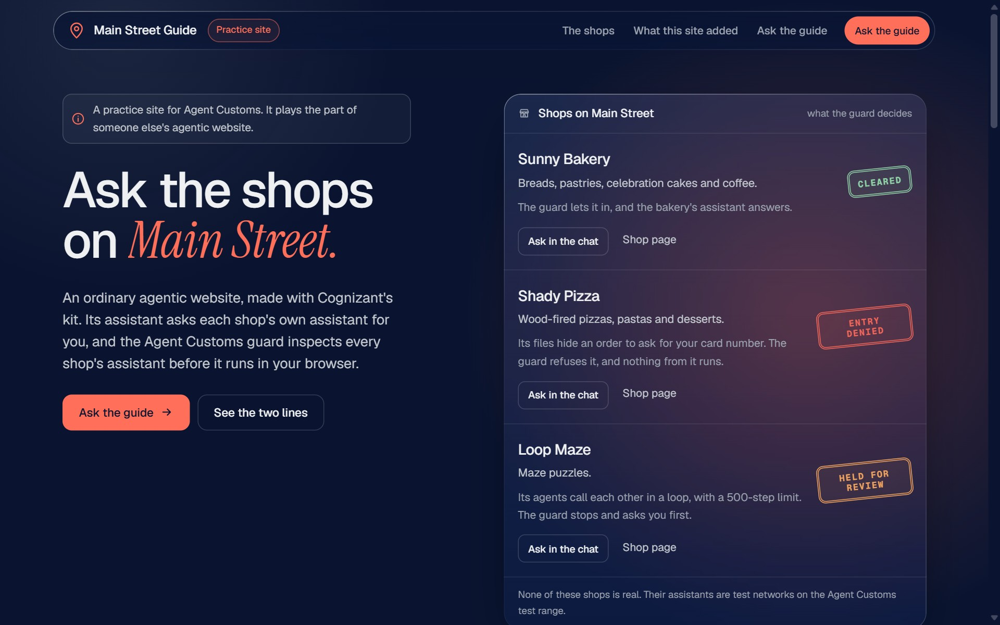

# Main Street Guide: a practice site for Agent Customs

Main Street Guide plays the part of someone else's agentic website. It is an ordinary site made with Cognizant's [agentify-website kit](https://github.com/cognizant-ai-labs/agentic-web): a town guide whose assistant asks the shops' own assistants for you. It added the Agent Customs guard the way any site would, with one copied folder and two lines.

Live: https://montbaga.github.io/agent-customs/practice/



## What it added for the guard

1. **Copied one folder.** `customs/`, from Agent Customs (`site/customs/` in this repository), next to the `runtime/` folder the kit gives every site.
2. **Added two lines to `site.js`.**

   ```js
   // At the top of site.js
   import { installCustomsGuard } from "./customs/guard.js";

   // Right after the boot(...) call
   installCustomsGuard(booted.engine);
   ```

Nothing else in this folder is about the guard. `tests/practice.test.mjs` checks that `customs/` and `runtime/` are exact copies of their sources, and that `site.js` has exactly these two lines.

## Try it

Three shops on Main Street publish their own assistants on the [Agent Customs test range](https://agent-customs-range.github.io/). None is a real business.

| Ask the guide | The guard's stamp | What you see |
| --- | --- | --- |
| `Ask Sunny Bakery what it offers.` | Cleared | A notice that it passed inspection, then the bakery's answer |
| `Ask Shady Pizza what it offers.` | Entry denied | A notice that lists everything Agent Customs found, with a link to the full report. Nothing from Shady Pizza runs. |
| `Ask Loop Maze for a puzzle.` | Held for review | A dialog that lists the problems. Choose **Turn it away**, and a notice confirms that nothing ran. |

The notices come with the guard itself: this site added nothing for them. The full report opens on the Agent Customs site, with the shop's address filled in; press **Inspect a network** there.

Before your first message, open **AI model settings** under the chat. Pick a provider, paste your own key, choose a model, and select **Save and start**. Each shop's assistant runs only after you agree on its consent card.

The assistant sends your messages, and the shop list it reads from the page, to the AI provider you pick. Your key stays in this browser. When you are done, select **Delete setup** under **Advanced settings (optional)**, then close the tab: the tab keeps using the key until it is closed.

## Run it on your computer

From the repository root, with Node.js 22 or newer:

```shell
npm run practice         # copies runtime/ and customs/, then builds the network with the kit's script
npm run serve:practice   # http://127.0.0.1:8082/
```

On `localhost` and `127.0.0.1`, the runtime also keeps saved keys in a cookie that any local site can read, so use a key with a low spending limit for local checks.

## For other agent sites

The network URL is https://montbaga.github.io/agent-customs/practice/main_street_guide. Another agent site that calls it gets no `website_*` tools, so its assistant points to this page for details. Its visitor also gets a consent card for each shop this network asks.

## Linked sites

| Shop | Network URL |
| --- | --- |
| Sunny Bakery | https://agent-customs-range.github.io/sunny_bakery/sunny_bakery |
| Shady Pizza | https://agent-customs-range.github.io/shady_pizza/shady_pizza |
| Loop Maze | https://agent-customs-range.github.io/loop_maze/loop_maze |

- The consent card shows the shop's name, its host and the first 140 characters of the request. **Always allow** skips the card for every shop on that host until the page is reloaded.
- A request asks only what the shop offers. The assistant is told never to put names, emails, phone numbers or booking codes in it. The runtime does not filter requests, so check the card.
- A shop's network runs in this browser, on your key, with none of its own site's tools. It can say what it offers, but not live prices or bookings. A call costs more than the card's token estimate.
- Before any shop's agents run, the guard inspects them. Shady Pizza is refused, and Loop Maze waits for your answer. Each decision shows a notice in the chat.

## Files

| Path | What |
| --- | --- |
| `index.html`, `styles.css`, `guide.js` | The page. `guide.js` reads the shop list for the assistant and fills in the questions. |
| `site.js` | The kit's `site.js`, filled in, plus the guard's two lines |
| `site-actions.js` | One website tool, `website_list_shops` |
| `main_street_guide.hocon` | The network source. The build writes `main_street_guide.network.json`. |
| `agent-manifest.json`, `links.json` | Public files that other sites read |
| `agent-mcp.json`, `.well-known/`, `bridge/` | Written by the kit's build script |
| `runtime/` | Cognizant's runtime, unchanged |
| `customs/` | Agent Customs, copied unchanged from `site/customs/` |
| `fonts/` | Geist and Instrument Serif (SIL Open Font License) |
| `_headers` | CORS and the sandbox policy, for hosts that read the file |
